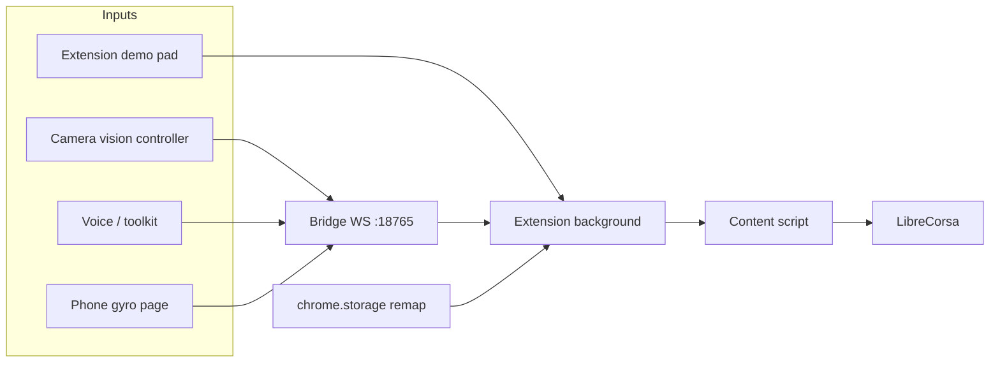

# Architecture

## Goal

Adapt [LibreCorsa](https://github.com/KhazP/librecorsa) so Justin (limited finger mobility) can remap camera, voice, and phone inputs onto the keyboard actions the game already understands — with **no extra hardware**.

New developers: [ONBOARDING.md](ONBOARDING.md).

## Components

| Path | Owner | Role |
| --- | --- | --- |
| `extension/` | Kevin | Chrome MV3: remap UI, WebSocket client, keystroke injection |
| `bridge/` | Omar (+ Kevin stub) | Local Node WebSocket hub; serves phone/camera/voice over LAN |
| `phone-controller/` | Omar / Kevin | DeviceOrientation → protocol events |
| `camera/` | Tim (Kevin backup) | MediaPipe vision controller (head/face/hand/finger) → protocol events |
| `voice/` | Bunny (demo); toolkit Controller for real integration | Speech → protocol events |
| `toolkit/` submodule | Bunny / Kevin | AI-for-Accessibility fork |
| `game/` submodule | upstream | LibreCorsa (unchanged for PoC) |
| `packages/shared/` | shared | Action IDs + protocol (vendored into extension) |

## Data flow

```text
Camera / Voice / Phone / Demo UI
          ↓  (JSON input events)
   Local bridge :18765
          ↓  WebSocket
   Chrome extension (remap table in chrome.storage)
          ↓  KeyboardEvent.code on window
   LibreCorsa tab (driving phase only)
```



Demo mode works **without** the bridge so day-one testing does not block on Omar.

## Keystroke injection (spike result)

LibreCorsa (`game/src/components/LibreCorsaSimulator.tsx`) listens for `window` `keydown` / `keyup` and maps `e.code` through `buildKeyLookup` (`game/src/lib/input/bindings.ts`). It does **not** check `event.isTrusted`.

| Path | Mechanism |
| --- | --- |
| Primary | Content script `dispatchEvent(new KeyboardEvent(...))` on `window` |
| Fallback | `page-hook.js` in the page MAIN world listens for `postMessage` from the content script |

Validated against LibreCorsa source on 2026-11-04 (codes like `KeyW`, `KeyA`, `Space`, `Escape`).

**Phase gate:** injection only matters while the sim phase is `driving`. Menus own the keyboard otherwise.

## Remapping

1. Input source sends logical `action` + `source` (e.g. phone + `tiltLeft`)
2. Extension builds key `phone:tiltLeft`
3. Looks up player remap → game action `steerLeft`
4. Looks up key code `KeyA` (or override)
5. Sends `{ type: "gnaa-apply", code, state }` to content scripts

Profiles live in `chrome.storage.local` and can be exported as JSON from Options.

### Camera steering and recovery

The head-only page (`/camera/head-steering.html`) calibrates a resting head yaw, smooths active motion, and
pulses the existing logical down/up events for partial steering. It does
not bypass the remap table or inject keys directly. The extension's
camera-only receiver tracks original mapped key codes, expires unrefreshed
holds after 800 ms, and releases camera keys when the bridge disconnects.
The camera UI separates bridge status from tracker status and provides
Start, Stop, Recenter, sensitivity, and direction controls. Keep it in a
separate visible window beside the game; a hidden camera page releases
steering. Details and manual checks: [camera/README.md](../camera/README.md).

### Vision controller layers

```text
getUserMedia
  → Face Landmarker (+ optional Gesture Recognizer)
  → continuous signals (pose, blendshapes, hand landmarks)
  → baseline calibration
  → interpreter (thresholds / hysteresis / hold|pulse|toggle)
  → camera:* input events (+ optional setRemap)
```

Camera detection profiles (enabled gestures, thresholds, calibration) live in the page `localStorage`. Game remapping stays in the extension (Options UI and/or `setRemap` from the camera page).

The vision controller remains the `/camera/` entry point. Its link to
`head-steering.html` exposes the independent head-only controller without
replacing gesture profiles or hand/face detection. Fresh valid vision frames
refresh toggle holds; camera pulses release after 120 ms. Both paths share
the camera receiver's expiry and the updated extension payload format.

## Why not the toolkit adapter runtime?

The toolkit’s `extension/` runs accessibility **page adapters** (DOM/CSS). Continuous racing input needs a dedicated content script + remap store. Voice still uses the toolkit **Controller**; Bunny maps phrases to bridge `input` events ([toolkit-contribution/](toolkit-contribution/)).

## Cross-platform

- Target: Chrome on Windows **and** macOS
- Prefer WebSocket + getUserMedia + Web Speech — no OS key hooks for the PoC
- ADB/USB phone path is out of scope for Saturday

## Deployment

Default: everything local (game `npm run dev`, bridge, Load unpacked).

Cloud (AWS / Render) only if needed to host a static phone page or demo — not required for latency-sensitive control. Localhost wins for the live co-designer test.
